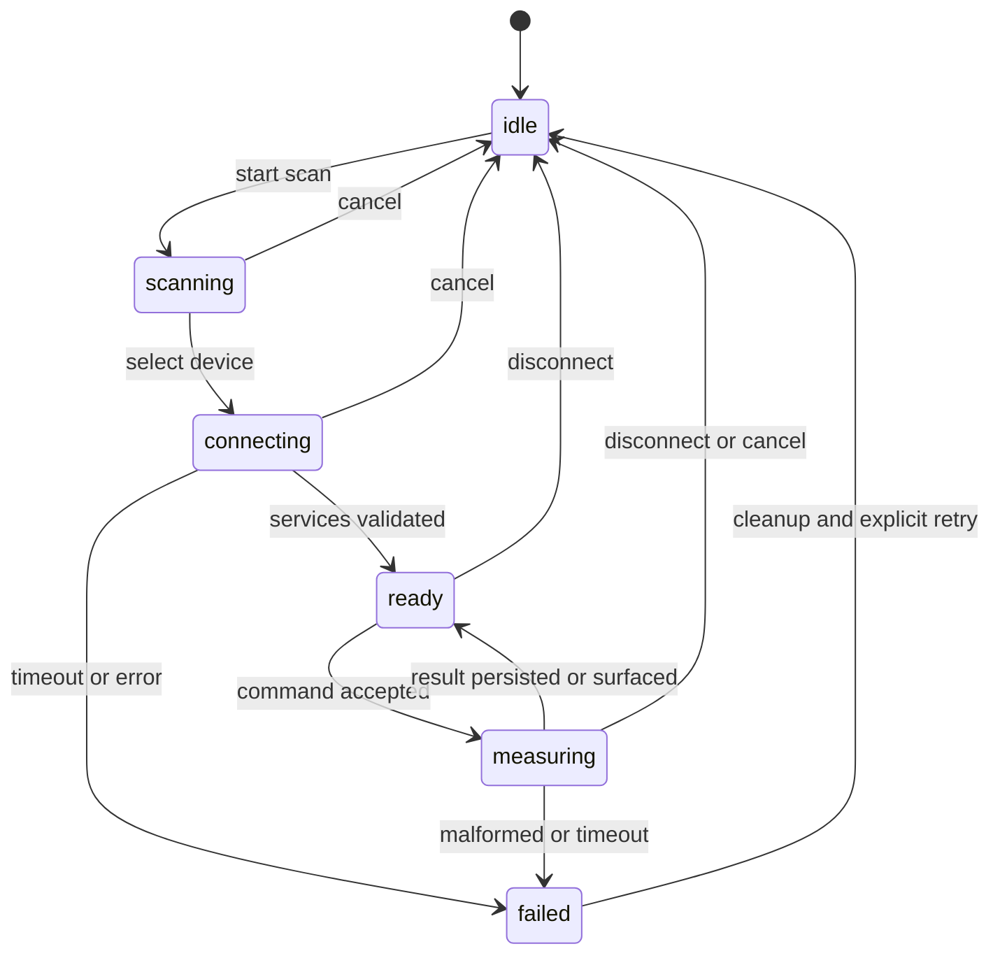

# DeviceTransport and MockDevice contract

Status: **Design only**. Method names below are a proposed contract, not compiled Swift source.

## Contract surface

| Operation | Proposed behavior |
| --- | --- |
| `scan()` | Returns a cancellable async stream of deduplicated domain device summaries |
| `connect(deviceID:)` | Connects one selected device with a deadline; confirms required services before ready |
| `disconnect()` | Idempotent teardown; cancels pending operations and releases resources |
| `send(command:)` | Validates ready state, serializes command, awaits matching response with timeout |
| `events()` | One ordered event stream per session: state, measurement, error, disconnect |

Use Sendable value types for device IDs, commands, events, measurements and errors.
Never expose CBPeripheral, CBCentralManager or SwiftData model instances through the contract.
The app coordinator owns one transport/session. Define bounded buffering when implementing streams;
never silently drop measurement events. UI discovery updates may coalesce.

## States and cancellation

Authorization/radio availability is a separate state (`unknown`, `denied`, `unsupported`, `poweredOff`, `available`).
Only `available` permits scanning. Any radio loss interrupts work and emits a typed reason.
All failure paths clean up before reconnect. Prevent overlapping scans/connects; repeated disconnect is safe.
Cancellation ends the relevant stream or operation promptly; no delayed callbacks may mutate a new session.
Use a session generation ID to reject stale callbacks. Define reconnect as bounded and user-visible;
no infinite automatic retry or assumption of background reconnection.

## CoreBluetoothTransport (planned)

Own manager/delegate operations on a consistent executor/serial queue and map callbacks into domain events.
Validate selected services/characteristics, framing, payload length, unit/version and response correlation.
Unknown UUIDs and packet format remain blocked pending a firmware contract.
Handle unauthorized, powered-off, disconnect mid-command, unsupported services and malformed packets.
Verify notification subscription and teardown on an actual iPhone with a specified peripheral.

## MockDevice (planned)

Implement the same contract with an injected clock and deterministic scripted fixtures; no real sleeps in unit tests.
Scenarios: happy path, no devices, denied permission, radio off, connect timeout, disconnect mid-measurement,
malformed payload, duplicate notification, stale event after reconnect, and cancellation.
Record scenario/seed in evidence. UI must show **模擬裝置 / 模擬資料** and persist `source = mock`.
MockDevice can be a deliberate demo mode; it must never silently replace a failed real BLE connection.

Run common contract tests against MockDevice and, where possible, the adapter with fake delegate inputs.
Only hardware integration tests can verify actual Core Bluetooth/peripheral interoperability.
