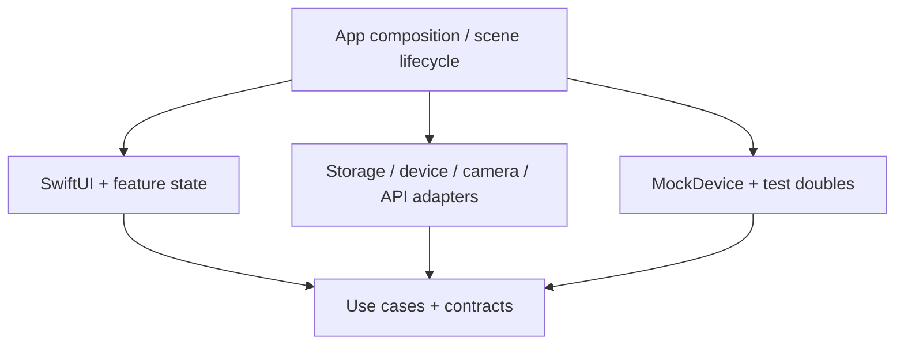

# Architecture plan

Status: **Proposed in Phase 00; no implementation or iOS validation.**

## Dependency boundaries

| Layer | Responsibility | Dependencies |
| --- | --- | --- |
| App | SwiftUI App entry, dependency composition, scene lifecycle | Presentation + concrete adapters |
| Presentation | Views and `@MainActor` observable feature state | Domain use cases / value types |
| Domain | Measurement workflow, validation, repository and transport contracts | Swift standard library / Foundation value types |
| Infrastructure | SwiftData persistence, Core Bluetooth, AVFoundation, URLSession | Domain contracts + Apple frameworks |
| TestSupport | Scripted MockDevice, fake API, clock, in-memory stores | Domain contracts; no real hardware |

Dependencies point toward Domain. Domain must not import UI/storage/BLE frameworks.
Start with folders in one app target; introduce packages only when isolation or reuse justifies them.

## Planned source layout (not created in Phase 00)

| Future path | Content |
| --- | --- |
| `EyeLink/App/` | `EyeLinkApp`, composition root, lifecycle coordinator |
| `EyeLink/Features/Devices/` | Discovery, connection, simulated mode indicator |
| `EyeLink/Features/Measurements/` | Capture/measurement state and results |
| `EyeLink/Features/Records/` | Offline history, detail, sync state |
| `EyeLink/Domain/` | Value models, use cases, contracts |
| `EyeLink/Infrastructure/Persistence/` | SwiftData models, repository, migration plan |
| `EyeLink/Infrastructure/Bluetooth/` | CoreBluetoothTransport, packet codec |
| `EyeLink/Infrastructure/Camera/` | AVFoundation adapter and permissions |
| `EyeLink/Infrastructure/Networking/` | REST client, DTO mapping, auth boundary |
| `EyeLink/Infrastructure/Sync/` | Outbox worker and retry policy |
| `EyeLink/TestSupport/` | MockDevice and deterministic fixtures |
| `EyeLink/Resources/` | Assets and localized permission descriptions |
| `EyeLinkTests/`, `EyeLinkUITests/` | Contract, use-case, persistence and UI tests |

## State and lifecycle

SwiftUI owns view state; observable feature models own loading, empty, success and failure transitions.
Use `scenePhase` at the app boundary to reconcile active/inactive/background transitions.
Cancel view-scoped tasks on disappearance; do not duplicate connection or sync workers on re-entry.
Plan foreground-only scanning and capture initially. Persist completed records and pending outbox work
before reporting success. On resume, refresh authorization and restore persisted pending work.
Suspension/termination is not a guaranteed final-save opportunity; do not rely on exit callbacks.

## Persistence and offline sync

- SwiftData `ModelContainer` is assembled once per app environment; use an in-memory store for tests.
- A repository adapter owns writes and exposes immutable domain values. Choose a model actor for background writes;
  keep a UI context on MainActor if needed. Never send model objects/contexts across actors.
- Proposed record: UUID, createdAt, updatedAt, device reference, source (`mock`/`ble`), schemaVersion,
  measurement payload, optional local photo reference, sync state, server revision.
- Measurement payload fields and units remain TBD until a device/domain contract is approved.
- Save record + outbox entry atomically in the same storage transaction; save failure must not show success.
- Outbox: stable operation UUID, record UUID, payload version, retry count, next attempt, last error class.
- Proposed sync: single worker; foreground/manual trigger; persisted backoff with jitter, bounded retries;
  retry network errors/429/5xx, respect Retry-After, stop and surface auth/validation errors.
- Duplicate delivery must use a stable idempotency key supported by the server. Lost ACK/relaunch may replay,
  so do not claim exactly-once delivery. Conflicts require version checks and visible resolution, not silent overwrite.
- Initial scope is append-only records; update/delete sync, tombstones and background sync need separate decisions.
- SwiftData local persistence does not implement arbitrary REST synchronization automatically.

## Camera, API and data boundaries

CameraService owns AVFoundation session work off the UI executor, permission state and resource teardown.
Start with still-image capture; no QR/ML interpretation is assumed. Store photos locally by reference;
do not upload them by default. Decide retention/deletion and file protection before implementation.

APIClient uses URLSession, Codable DTOs, HTTPS, timeouts and cancellation, mapping errors to domain cases.
Backend base URL, auth method, schema, version/conflict and idempotency contracts are pending.
Use fake responses for early tests. Tokens belong in Keychain at runtime and CI secret storage for CI-only keys.
Logs must redact tokens, images, measurement payloads and device identifiers.

## References

- [Apple SwiftData ModelContainer](https://developer.apple.com/documentation/swiftdata/modelcontainer)
- [Apple ModelContext](https://developer.apple.com/documentation/swiftdata/modelcontext)
- [Apple sensor authorization and usage descriptions](https://developer.apple.com/documentation/technologyoverviews/device-sensors)
